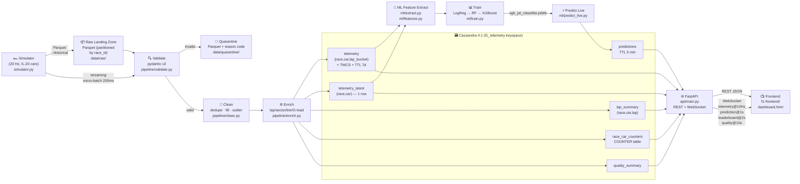

# Architecture — F1 Telemetry Pipeline

## System Architecture Diagram

## Data Flow Summary

| Stage | Module | Input | Output |
|-------|--------|-------|--------|
| **Simulation** [DE] | `simulator/simulator.py` | CLI args | Parquet files in `data/raw/` |
| **Validation** [DE] | `pipeline/validate.py` | Parquet | Valid rows + quarantine |
| **Cleaning** [DE] | `pipeline/clean.py` | Valid rows | Deduplicated, imputed, outlier-corrected rows |
| **Enrichment** [DE] | `pipeline/enrich.py` | Cleaned rows | Rows + lap_number, sector, tire_wear_rate, G-cumulative, etc. |
| **Ingestion** [AD] | `ingestion/writer.py` | Enriched rows | Written to Cassandra (4 tables + counters) |
| **Feature extraction** [ML] | `ml/extract.py` + `ml/features.py` | Cassandra rows | Feature matrix (pandas DataFrame) |
| **Training** [ML] | `ml/train.py` | Feature matrix | Saved model `.joblib` |
| **Live inference** [ML] | `ml/predict_live.py` | Cassandra latest | `predictions` table row |
| **API** [AD] | `api/main.py` | Cassandra | JSON / WebSocket |

## Key Design Decisions

1. **Query-first Cassandra tables**: every table exists to serve one specific access pattern. No ad-hoc queries.
2. **No Kafka/message broker**: at 400 writes/s, a direct Python → Cassandra pipeline is sufficient for this scale. A Kafka adapter would add value above 10 000 writes/s.
3. **Lap bucket partitioning**: keeps `telemetry` partitions under 15 000 rows each.
4. **Same cleaning code for batch and streaming**: `pipeline/clean.py` is imported by both `run_batch.py` and `run_stream.py` — no training-serving skew.
5. **Cassandra as single source of truth**: the WebSocket feed reads from Cassandra, not an in-process cache.
